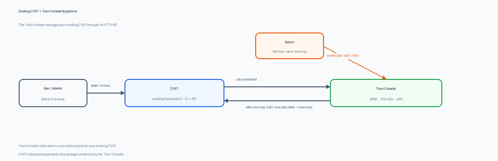
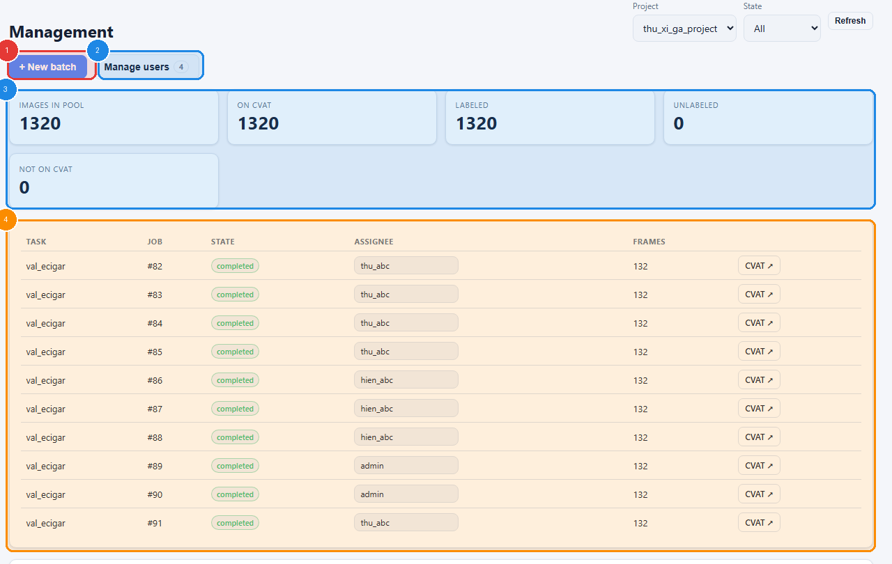
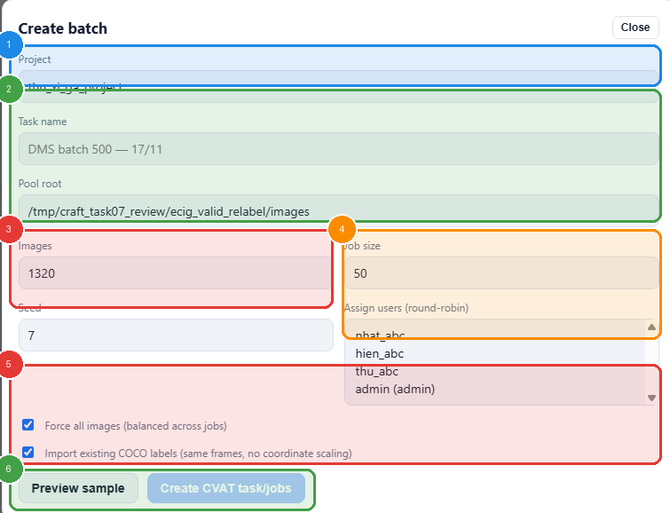
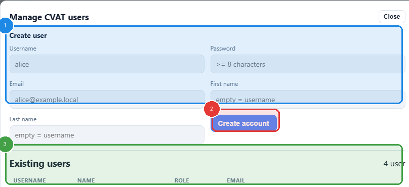
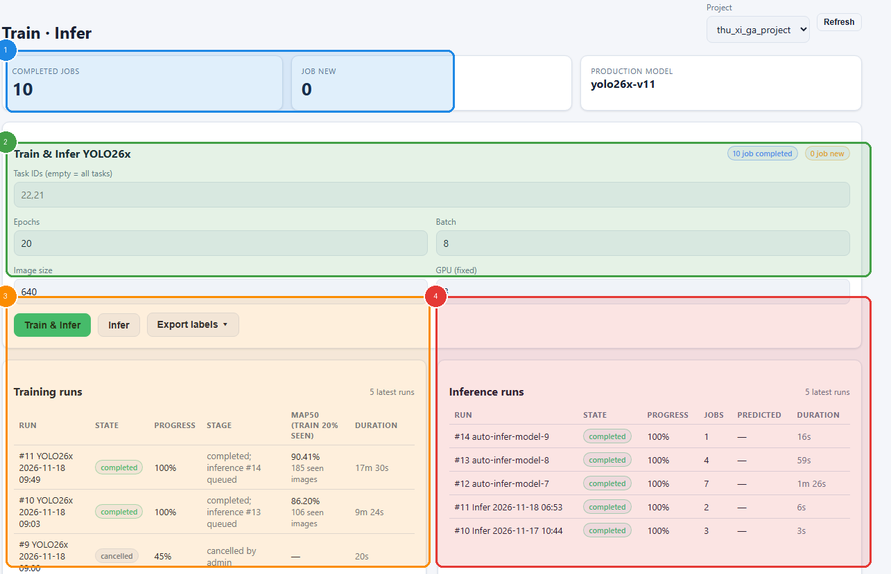

# Train Console — handoff package

A compact **training management** service for an **existing CVAT deployment**.
It connects to CVAT through its HTTP API; CVAT itself is not part of this
package.

What it does:

- create labeling batches from an image pool and push them to CVAT;
- assign CVAT users, create/delete labeler accounts;
- train YOLO26x or RF-DETR-2XL on completed jobs and run inference on `new` jobs;
- track progress, cancel runs, export COCO labels, manage model versions.

Ports:

```text
http://<host>:9080   Train Console (this package)
http://<cvat-host>:<cvat-ui-port>       existing CVAT UI
http://<cvat-host>:<cvat-api-port>      existing CVAT API
```



*The console creates jobs in the existing CVAT, waits for completed jobs,
trains, then re-infers jobs that are still `new`.*

**Contents:** [UI walkthrough](#ui-walkthrough) ·
[Quick start](#quick-start) · [Handoff checklist](docs/HANDOFF_CHECKLIST.md) ·
[Setup guide](docs/SETUP_GUIDE.md) ·
[Data format](docs/DATA_FORMAT.md) · [Operations](docs/OPERATIONS.md)

## What is included / not included

| Included | Not included |
|---|---|
| FastAPI console + worker | CVAT server/UI |
| YOLO26x training/inference | SAM2 serverless function |
| Batch creation + user management | CVAT UI proxy / GT overlay |
| COCO label import/export | CVAT Docker images |

Use your existing CVAT; only `TC_CVAT_URL` and `TC_CVAT_UI_URL` need to point to
it.

## UI walkthrough

Screenshots from a reference deployment; numbers match the bullets.

### 1. Management — the admin home page



1. **+ New batch** — create a CVAT task/job set from the image pool.
2. **Manage users** — create/delete labeler accounts and view credentials.
3. **KPIs** — images in pool, on CVAT, labeled, unlabeled, not on CVAT.
4. **Job table** — state, assignee, frames and a direct **CVAT ↗** link.
   Click the assignee box and type a few letters to search a user; selecting
   saves immediately to CVAT.

### 2. Create a batch



1. **Project** — the CVAT project selected on the Management page (read-only).
2. **Task name / Pool root** — task name in CVAT and the image folder.
3. **Images / Seed** — number of images to take and the deterministic seed.
4. **Job size / Assign users** — frames per CVAT job and round-robin users.
5. **Force all images** (default tick) — take every remaining image and order
   them round-robin by source, so each job covers many clips. Untick to use
   `Images` + the diversity sampler (KMeans medoid, 10% audit, max 12 per clip,
   min frame gap 10, near-duplicate removal); selected images keep the original
   pool path order.
   **Import existing COCO labels** imports boxes by `file_name` with no scaling.
6. **Preview sample → Create CVAT task/jobs** — preview the selection, then
   upload to the existing CVAT.

### 3. Manage CVAT users



1. **Create user** — username, password, email, names. Empty names default to
   the username.
2. **Create account** — creates the account in CVAT.
3. **Existing users** — click a row to see the username and stored password.
   Use **Set password** (blank = generate) for accounts created before the
   console stored credentials.

### 4. Training and inference



1. **KPIs** — completed jobs, new jobs, production model.
2. **Train form** — model (**YOLO26x** or **RF-DETR-2XL**), Task IDs
   (empty = all), epochs, batch (**per GPU**; RF-DETR multi-GPU training uses
   this batch on every GPU, single-GPU training uses auto), image size,
   GPU (single id or `0,1,3`). **Test** shows the YOLO max batch and an
   RF-DETR batch calibrated from the last run plus current free VRAM.
   - **Train**: train on all completed jobs only. Use **Infer** separately to
     update `new` jobs.
   - **Infer**: inference only, newest weights of the selected family. It uses
     the GPU list and batch from the form. Opens a dialog with two modes:
     **all new jobs** (respects Task IDs above) or **specific job IDs**
     (comma-separated; jobs not in state `new` are skipped).
   - **Compare 50**: choose **View last compare** (cached result) or
     **Run new 50 images**. It uses the GPU/batch from the form, shows GT
     (green), YOLO (blue) and DETR (red) on the same image, and is read-only:
     no CVAT writes.
   - **Export labels**: COCO JSON for completed jobs only or all jobs.
3. **Training runs** — 5 latest, per-epoch progress, mAP50 (train 20% seen),
   duration, and **Cancel** while queued/running.
4. **Inference runs** — 5 latest, jobs/predicted counts and duration.

## Folder layout

```text
.
├── trainconsole/              # FastAPI console + worker + YOLO runner
├── pipeline/                  # sampling utilities (KMeans / diversity)
├── deploy/
│   └── tc_worker.sh           # worker supervisor
├── docs/
│   ├── HANDOFF_CHECKLIST.md   # what to send + colleague steps (Vietnamese)
│   ├── SETUP_GUIDE.md         # step-by-step (Vietnamese)
│   ├── DATA_FORMAT.md
│   ├── AGENT_PROMPT.md
│   ├── OPERATIONS.md
│   └── images/                # screenshots used by this README
├── data/                      # put the image pool here (gitignored)
├── assets/                    # optional local weights (gitignored)
├── .env.example
├── requirements-console.txt
└── requirements-train.txt
```

## Quick start

> Hướng dẫn từng bước bằng tiếng Việt: **`docs/SETUP_GUIDE.md`**.

### 0. Existing CVAT

You need:

- a CVAT instance with an admin account;
- its API URL (e.g. `http://cvat-host:51102`);
- its UI URL that users open (e.g. `http://cvat-host:8081`);
- network access from this machine to the CVAT API.

### 1. Python environments

```bash
# console + worker (Python 3.10+)
conda create -n trainconsole python=3.11 -y
conda activate trainconsole
pip install -r requirements-console.txt

# training (separate env, e.g. "tanmai")
conda create -n tanmai python=3.10 -y
conda activate tanmai
pip install torch torchvision --index-url https://download.pytorch.org/whl/cu121
pip install -r requirements-train.txt

# RF-DETR-2XL (separate env, Python >= 3.10; torch >= 2.6)
conda create -n rfdetr python=3.10 -y
conda activate rfdetr
pip install torch torchvision --index-url https://download.pytorch.org/whl/cu124
pip install -r requirements-console.txt
pip install ultralytics "rfdetr[train,plus]"
```

RF-DETR-2XL weights are under the Roboflow PML-1.0 license (commercial
self-hosting requires the Roboflow Enterprise add-on; confirm with your
organisation). The `rfdetr` training env is also the recommended
`TC_WORKER_PYTHON` when using RF-DETR inference.

### 2. Configure

```bash
cp .env.example .env
# edit TC_CVAT_PASSWORD, TC_GPU, TC_TRAIN_PYTHON, TC_RFDETR_PYTHON,
# TC_WORKER_PYTHON, TC_POOL_ROOT...
```

```text
TC_CVAT_URL=http://cvat-host:51102     # API
TC_CVAT_UI_URL=http://cvat-host:8081   # UI opened by users
TC_CONSOLE_PORT=9080
```

### 3. Add data

```text
data/pool/
├── labels.json                  # optional COCO
└── <source>/<clip>/*.jpg
```

See `docs/DATA_FORMAT.md`. For agent-based formatting, use
`docs/AGENT_PROMPT.md`.

### 4. Start the console and worker

```bash
./run_console.sh          # http://<host>:9080
./deploy/tc_worker.sh     # keep running (crash-safe supervisor)
```

Login with `TC_ADMIN_USERNAME` / `TC_ADMIN_PASSWORD` (default `admin`/`admin`).

## Features

- **Management** (`/management`): project switcher, pool/CVAT/labeled KPIs,
  batch creation (diversity sampler or *Force all images*), assignee search,
  CVAT account creation/deletion with stored passwords, per-user progress.
- **Training** (`/training`): one **Train** button, separate **Infer**,
  **Export labels** (COCO: completed/all), 5 latest runs, per-epoch progress,
  cancel button. Exports are cached per job, so retraining only downloads
  newly completed or re-annotated jobs. After a successful run, only the
  newest checkpoint **per project and model family** is kept; the other
  family is untouched so Compare can use both.
- **Weights**: YOLO starts from `yolo26x.pt`; RF-DETR starts from the
  COCO-pretrained `RFDETR2XLarge` checkpoint. Later runs tune the newest
  checkpoint of the same family. Inference uses the family selected in the
  form.
- **Inference** runs on all `new` jobs or a chosen list of job IDs, only
  touches `new` jobs, replaces boxes, keeps masks, re-checks state before
  writing. YOLO26 is end-to-end, so the console applies NMS plus a containment
  filter.
- **Worker supervisor**: restarts the worker on crash, cron `@reboot` support.

## Heavy files

Nothing heavy is committed. The normal install downloads everything:

- YOLO26x base weights: downloaded by Ultralytics on first use
- trained checkpoints: generated under `var/trainconsole/train_runs/`

See `WEIGHTS.md`. `assets/` is gitignored and only for offline copies.

## Limitations

- Requires an existing CVAT with admin credentials.
- Single admin account; no multi-tenant permissions.
- SQLite by default (Postgres can be used via `TC_DATABASE_URL`).
- Seen-validation mAP (20% of train images) measures memorization, not
  generalization.
- Password reset uses `docker exec cvat_server`, so it only works when the
  console runs on the CVAT Docker host; otherwise use CVAT's own admin UI.
